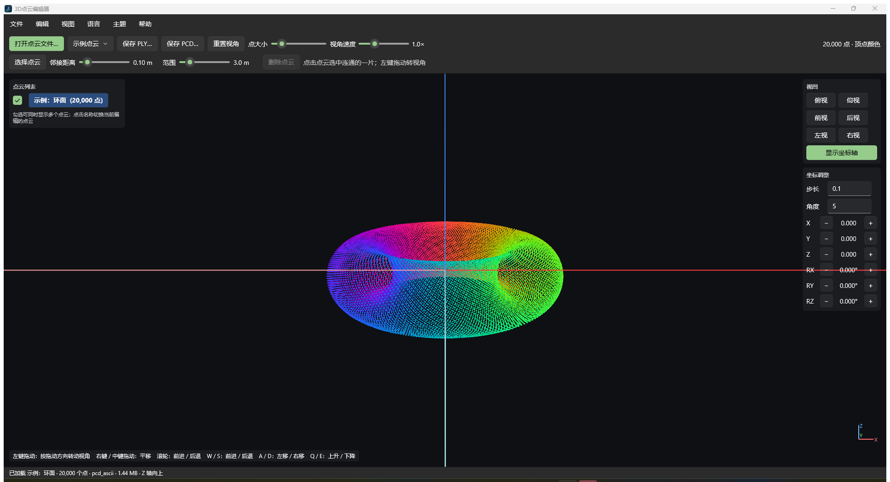
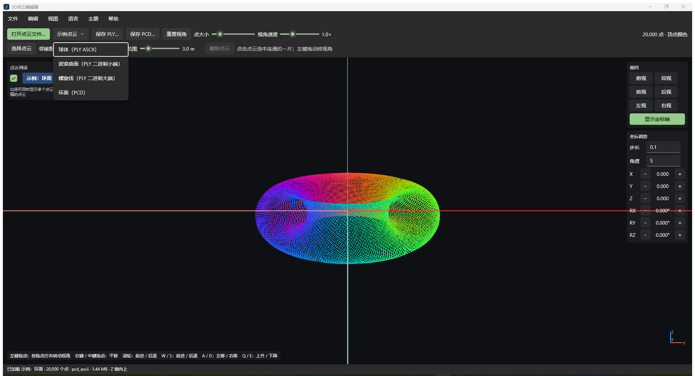
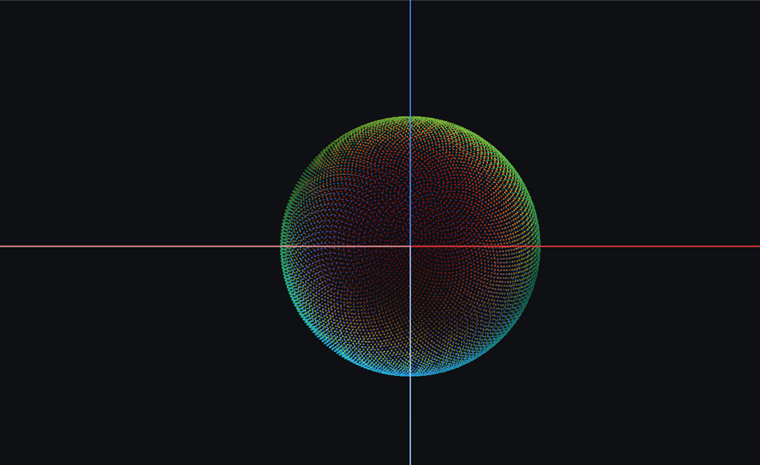
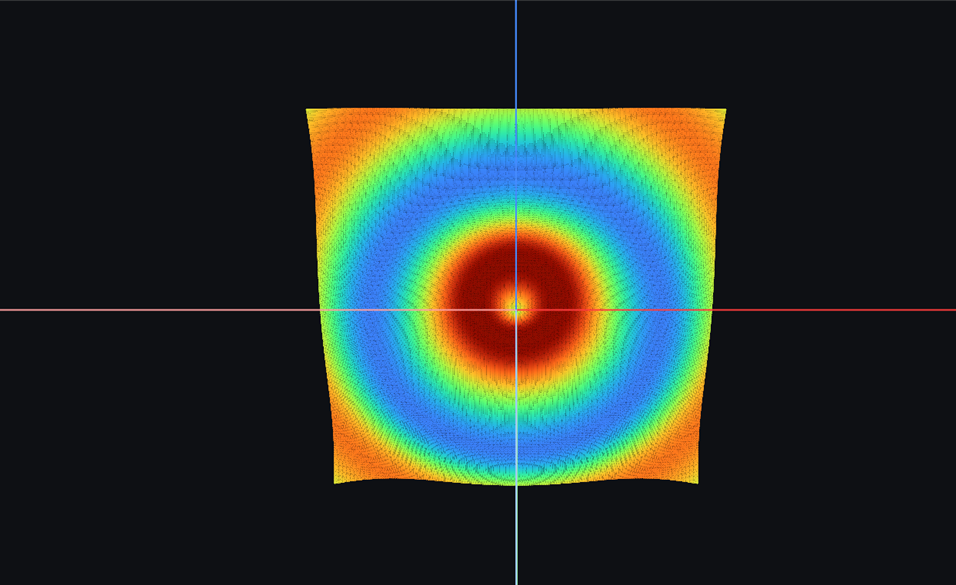
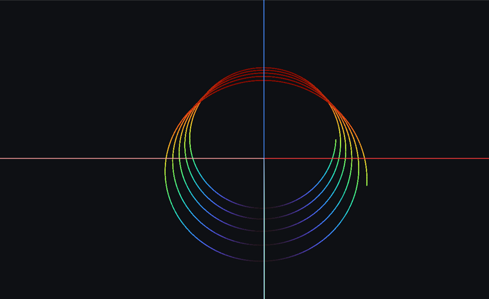
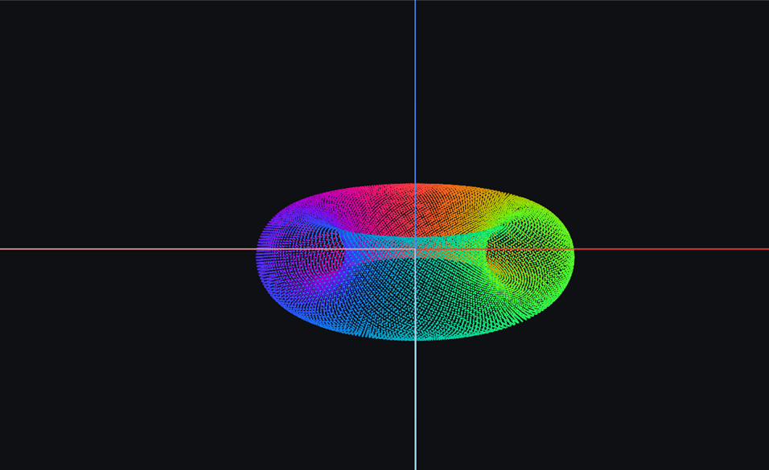

[中文](README.md) | **English**

# 3D Point Cloud Editor

**A Windows desktop point-cloud viewer and editor** built with WinUI 3 + DirectX 12 in C++20.

Open `.ply` / `.pcd` files, render colored point clouds, orbit/pan/zoom freely. Show several
clouds at once, select a connected region of points and delete it, translate/rotate a cloud,
and save back to PLY or PCD.

[](#requirements)
[](#build)

[](LICENSE.txt)



## Features

- **Open clouds** — menu, toolbar, drag & drop, or command line; PLY and PCD are detected automatically
- **Multiple clouds** — every open adds an entry to the left list; tick to display, click a name to edit
- **Rendering** — D3D12 point list with geometry-shader point sprites, depth testing and normal lighting;
  vertices are uploaded in 16M-point chunks, so point count has no hard cap
- **Camera** — left drag to orbit, right/middle drag to pan, wheel to dolly, `WASDQE` to fly;
  six standard views and a one-click re-frame
- **Cluster selection** — click the cloud to region-grow a connected patch by *adjacency distance*,
  trim it with an XYZ bounding box, then delete it
- **Transform** — translate along X/Y/Z and rotate around RX/RY/RZ with adjustable step and angle
- **Save** — write `binary_little_endian` PLY or `binary` PCD, keeping colors and normals
- **Polish** — follows the system light/dark theme live, Chinese/English UI, 4 built-in sample clouds

## Quick start

### Run it (no installation)

The build output lives in `x64\Release\`. Copy the **whole folder** and double-click
`3dPointCloudEditor.exe` — the Windows App SDK / WinUI runtime ships next to the exe, so nothing
has to be installed on the target machine.

> The folder does **not** include the VC++ runtime. If Windows reports a missing `MSVCP140.dll` /
> `VCRUNTIME140.dll`, install the
> [VC++ redistributable](https://aka.ms/vs/17/release/vc_redist.x64.exe) once.

### Requirements

| Item | Requirement |
| --- | --- |
| OS | Windows 10 1809 (17763) or later |
| Visual Studio | 2022 / 2026 with *Desktop development with C++* and the Windows App SDK C++ templates |
| Windows SDK | 10.0.26100 (or later) |
| GPU | DirectX 12 capable; falls back to WARP software rendering when there is no discrete GPU |

### Build

```powershell
# Restore NuGet packages before the first build (Visual Studio usually does it for you;
# otherwise right-click the solution → "Restore NuGet Packages")
msbuild .\3dPointCloudEditor\3dPointCloudEditor.vcxproj /p:Configuration=Release /p:Platform=x64
```

Output is flat in `x64\Release\` (`x64\Debug\` for Debug): `3dPointCloudEditor.exe`,
`3dPointCloudEditor.pri`, `app.ico`, `samples\`, and the Windows App SDK runtime DLLs.

You can also open `3dPointCloudEditor.slnx` in Visual Studio and press `F5`. The project is an
**unpackaged** app, so F5 does not deploy an MSIX package — it just launches the built exe.

### Build a Setup.exe

To hand the app to someone else, build an Inno Setup installer (per-user, no admin rights needed):

```powershell
powershell -ExecutionPolicy Bypass -File .\tools\make-installer.ps1
```

Output: `dist\3dPointCloudEditor-<version>-setup.exe` (~34 MB, bundles the Windows App SDK and
VC++ runtime). The first run needs Inno Setup's `ISCC.exe`; the script looks for it in `PATH`, under
`%LocalAppData%\Programs\InnoSetupNuget\*\tools\`, and in `Program Files`.

### Command line

```powershell
3dPointCloudEditor.exe D:\data\scan.ply   # open this file on startup
3dPointCloudEditor.exe D:\data\scan.pcd
3dPointCloudEditor.exe --demo             # open the sample torus on startup
```

## Controls

| Input | Action |
| --- | --- |
| Left drag | Orbit (camera position stays put) |
| Right / middle drag | Pan in the screen plane |
| Wheel | Dolly along the view direction (1% of current distance per notch) |
| `W` `S` / `A` `D` / `Q` `E` | Forward/back, strafe, up/down |
| Drop a file | Open that `.ply` / `.pcd` |
| *Select Points* toggle | Enter cluster-selection mode; click to select a connected region (red) |
| *Adjacency* / *Range* sliders | Max gap between neighbors / max growth radius from the clicked point |
| XYZ boundary sliders | Trim the current selection with a bounding box |
| *Delete Points* | Delete the selection and re-upload the cloud |
| *Point Size* / *View Speed* | On-screen point size in pixels / interaction speed multiplier |
| *Save PLY…* / *Save PCD…* | Save the current cloud (including edits) |

Selected points are drawn from a separate red vertex buffer, so dragging the sliders only rebuilds
that small buffer instead of re-uploading the whole cloud.

## Supported formats

| Format | Encoding | Optional attributes |
| --- | --- | --- |
| PLY | `ascii`, `binary_little_endian`, `binary_big_endian` | colors `red/green/blue`, normals `nx/ny/nz`, intensity |
| PCD | `ascii`, `binary`, `binary_compressed` (built-in LZF decompression) | `rgb` / `rgba`, `normal_x/y/z`, `intensity` |

When a cloud has neither colors nor intensity, it is colored by Z height with a Turbo colormap.
Field order is free and extra components are ignored; non-vertex elements such as `face` are skipped.
Full details (in Chinese): [docs/formats.md](docs/formats.md).

The 4 files in `samples/` are both test data and the content of the **Demo Cloud ▾** toolbar menu
(sphere / wave / helix / torus, covering ASCII, binary LE/BE and PCD):



What the four samples look like (screenshots taken after opening each from the menu):

| Sphere (PLY ASCII, 10k points) | Wave (PLY binary LE, 90k points) |
| :---: | :---: |
|  |  |
| **Helix (PLY binary BE, 6k points)** | **Torus (PCD, 20k points)** |
|  |  |

## Project layout

```
3dPointCloudEditor.slnx
3dPointCloudEditor/          # the app (WinUI 3 + D3D12)
  MainWindow.xaml(.cpp/.h)   # UI, input, render loop
  PointCloudRenderer.*       # D3D12 device/swap chain/PSO/upload/draw
  PlyLoader.*                # PLY / PCD parsing and saving
  OrbitCamera.h              # orbit camera
  SelectionVolume.h          # selection plane / polygon / prism tests
samples/                     # 4 sample clouds (also the "Demo Cloud" menu)
tests/                       # self-check programs + runner + test clouds
tools/                       # icon generator
docs/                        # architecture, format details, troubleshooting, screenshots
```

Implementation notes (root signature, point sprites, chunked upload, clustering) are in
[docs/architecture.md](docs/architecture.md) (Chinese).

## Self-checks

`tests/` contains two dependency-free C++ self-check programs that compile the app's real headers:

```powershell
powershell -ExecutionPolicy Bypass -File .\tests\build-test.ps1
```

They cover PLY/PCD parsing for all three encodings, save/load round-trips, camera handedness and
interaction directions, speed multipliers, selection geometry and pole stability. Scratch files go
to `tests\scratch\` (git-ignored).

## Known limitations

- Points only — no mesh or texture rendering; `face` elements in PLY/PCD are skipped
- Cluster selection supports delete only, no undo (re-open the file to restore)
- A single selection is capped at 800k points, growth radius 0–20 m (lower the adjacency distance for large scenes)
- A CPU copy of the vertices is kept to support deletion, roughly 28 bytes per point
- No LOD: frame rate on clouds with hundreds of millions of points depends on the GPU

## Contributing

Issues and pull requests are welcome. Please run `tests\build-test.ps1` before submitting, and keep
the existing bilingual UI strings and code style.

## License

[Apache License 2.0](LICENSE.txt)

## More docs (Chinese)

- [Architecture and rendering](docs/architecture.md)
- [PLY / PCD details](docs/formats.md)
- [Troubleshooting](docs/troubleshooting.md)
