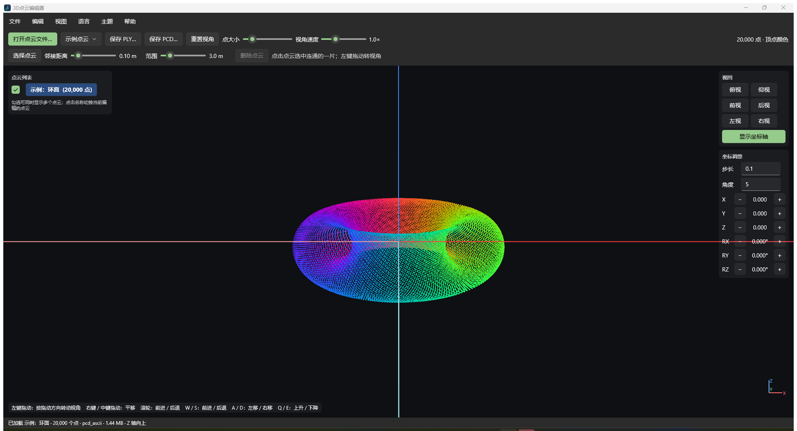
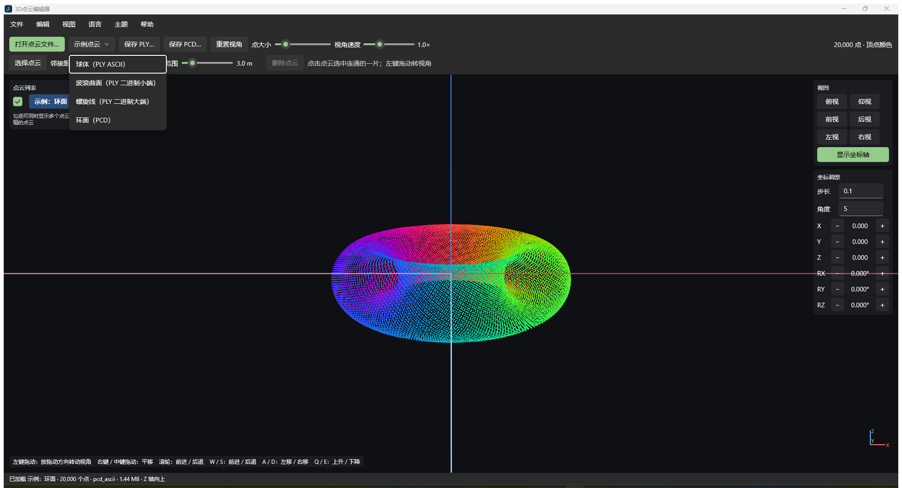

# 3D 点云编辑器

**Windows 桌面点云查看与编辑工具** —— WinUI 3 + DirectX 12，用 C++20 写成。

打开 `.ply` / `.pcd` 文件，彩色渲染点云，自由旋转/平移/缩放；支持多点云同时显示、
按连通性选取一片点并删除、整体平移旋转、另存为 PLY 或 PCD。

[](#环境要求)
[](#构建)

[](LICENSE.txt)



## 功能

- **打开点云**：菜单、工具栏、拖放文件、命令行参数四种入口；PLY 与 PCD 自动识别
- **多点云**：每次打开都加入左侧列表，勾选即可同时显示，点击名称切换当前编辑对象
- **渲染**：D3D12 点列表 + 几何着色器点精灵、深度测试、法线光照；按 1600 万点分块上传，点数不设硬上限
- **视角**：左键旋转、右键/中键平移、滚轮前后、`WASDQE` 移动；六个标准视图一键切换，`重置视角` 自动取景
- **聚类选择**：左键点一片点云，按“邻接距离”做区域生长选中连通区域，再用 XYZ 边界盒裁剪，最后删除
- **坐标调整**：当前点云沿 X/Y/Z 平移、绕 RX/RY/RZ 旋转，步长与角度可调
- **保存**：另存为 `binary_little_endian` PLY 或 `binary` PCD，保留颜色与法线
- **体验**：跟随系统深浅色并实时切换、中英文界面、4 个内置示例点云

## 快速开始

### 直接运行（免安装）

构建产物在 `x64\Release\`，**整个目录**拷走后双击 `3dPointCloudEditor.exe` 即可运行
（已自带 Windows App SDK / WinUI 运行时，目标机无需预装）。

> 目录里不含 VC++ 运行库。目标机若提示缺少 `MSVCP140.dll` / `VCRUNTIME140.dll`，
> 装一次 [VC++ 可再发行组件](https://aka.ms/vs/17/release/vc_redist.x64.exe) 即可。

### 环境要求

| 项目 | 要求 |
| --- | --- |
| 系统 | Windows 10 1809 (17763) 及以上 |
| Visual Studio | 2022 / 2026，含“使用 C++ 的桌面开发”与 Windows App SDK C++ 模板 |
| Windows SDK | 10.0.26100（或更高） |
| 显卡 | 支持 DirectX 12；无独显时自动回退到 WARP 软件渲染 |

### 构建

```powershell
# 首次构建前先还原 NuGet 包（用 VS 打开解决方案时通常会自动还原；
# 也可右键解决方案 →“还原 NuGet 包”）
msbuild .\3dPointCloudEditor\3dPointCloudEditor.vcxproj /p:Configuration=Release /p:Platform=x64
```

产物平铺在 `x64\Release\`（Debug 为 `x64\Debug\`）：`3dPointCloudEditor.exe`、
`3dPointCloudEditor.pri`、`app.ico`、`samples\` 以及 Windows App SDK 运行时 DLL。

也可以在 Visual Studio 里打开 `3dPointCloudEditor.slnx` 直接 `F5`（项目是**非打包**应用，
不部署 MSIX，F5 只是启动生成的 exe）。

### 命令行参数

```powershell
3dPointCloudEditor.exe D:\data\scan.ply   # 启动即加载指定文件
3dPointCloudEditor.exe D:\data\scan.pcd
3dPointCloudEditor.exe --demo             # 启动即打开示例环面
```

## 操作

| 操作 | 效果 |
| --- | --- |
| 左键拖动 | 转动视角（相机位置不动） |
| 右键 / 中键拖动 | 沿屏幕平面平移 |
| 滚轮 | 沿视线前进 / 后退（每刻度 1% 当前距离） |
| `W` `S` / `A` `D` / `Q` `E` | 前进后退 / 左右平移 / 上升下降 |
| 拖入文件 | 打开该 `.ply` / `.pcd` |
| `选择点云` 开关 | 进入聚类选择模式，左键点击选中连通区域（红色） |
| `邻接距离` / `范围` 滑杆 | 相邻点最大间距 / 以点击点为中心的最大生长范围 |
| XYZ 边界控制条 | 用包围盒进一步裁剪已选中的区域 |
| `删除点云` | 删除当前选区并重新上传 |
| `点大小` / `视角速度` | 点的屏幕像素尺寸 / 交互速度倍率 |
| `保存 PLY…` / `保存 PCD…` | 另存当前点云（含编辑结果） |

聚类结果用一份红色顶点缓冲覆盖绘制，调滑杆只重建这份小缓冲，不重新上传整片点云。

## 支持格式

| 格式 | 编码 | 可选属性 |
| --- | --- | --- |
| PLY | `ascii`、`binary_little_endian`、`binary_big_endian` | 颜色 `red/green/blue`、法线 `nx/ny/nz`、灰度 `intensity` |
| PCD | `ascii`、`binary`、`binary_compressed`（内置 LZF 解压） | `rgb` / `rgba`、`normal_x/y/z`、`intensity` |

没有颜色也没有强度时，按 Z 高度用 Turbo 伪彩色显示。字段顺序任意、多余分量忽略，
`face` 等非顶点元素跳过。完整规则见 [docs/formats.md](docs/formats.md)。

`samples/` 下的 4 个文件既是测试数据，也是工具栏 **示例点云 ▾** 菜单的内容
（球体 / 波浪曲面 / 螺旋线 / 环面，覆盖 ASCII、二进制小端/大端和 PCD）：



## 项目结构

```
3dPointCloudEditor.slnx
3dPointCloudEditor/          # 应用本体（WinUI 3 + D3D12）
  MainWindow.xaml(.cpp/.h)   # 界面、交互、渲染循环
  PointCloudRenderer.*       # D3D12 设备/交换链/PSO/顶点上传/绘制
  PlyLoader.*                # PLY / PCD 解析与保存
  OrbitCamera.h              # 轨道相机
  SelectionVolume.h          # 选择平面 / 多边形 / 棱柱判定
samples/                     # 4 个示例点云（也是“示例点云”菜单内容）
tests/                       # 自检程序 + 运行脚本 + 测试点云
tools/                       # 图标生成脚本
docs/                        # 架构说明、格式细节、排查手册、截图
```

实现细节（根签名、点精灵、分块上传、聚类算法）见 [docs/architecture.md](docs/architecture.md)。

## 自检

`tests/` 下有两个无依赖的 C++ 自检程序，直接编译应用里的真实头文件：

```powershell
powershell -ExecutionPolicy Bypass -File .\tests\build-test.ps1
```

覆盖 PLY/PCD 三种编码解析、保存往返、相机手性/交互方向/速度倍率、选择几何与极点稳定性。
生成的临时文件写到 `tests\scratch\`（已 gitignore）。

## 已知限制

- 只显示顶点，不渲染面片/纹理；PLY/PCD 里的 `face` 会被跳过
- 聚类选择只支持删除，不支持撤销（重新打开文件即可恢复）
- 聚类单次最多选中 80 万点、生长范围 0–20 米（可调小邻接距离）
- 为支持删除会保留一份 CPU 顶点副本，内存约 28 字节/点
- 未做 LOD，亿级点云的交互帧率取决于显卡

## 贡献

欢迎 Issue 和 PR。提交前请跑一遍 `tests\build-test.ps1`，并保持现有的中英文文案、代码风格。

## 许可

[Apache License 2.0](LICENSE.txt)

## 更多文档

- [架构与渲染实现](docs/architecture.md)
- [PLY / PCD 支持细节](docs/formats.md)
- [排查手册](docs/troubleshooting.md)
